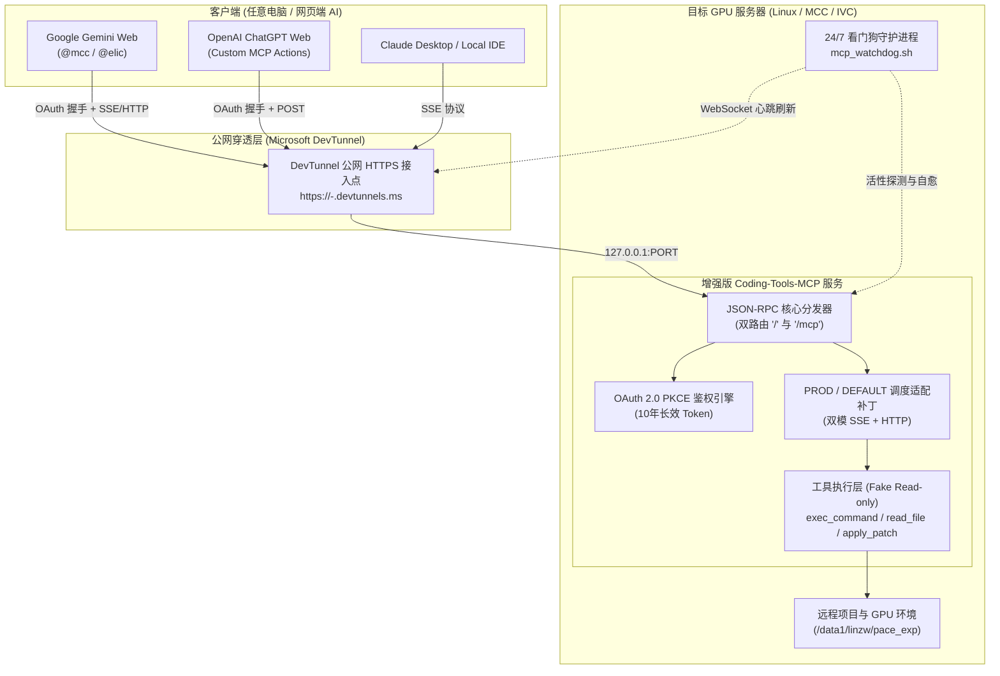

# MCP 远程服务器与多模型 Web AI (Gemini & ChatGPT) 互联套件

本套件为在远程 GPU / Linux 服务器上部署 **Model Context Protocol (MCP)** 代码执行环境提供了完整的工程化模板与自动化补丁。通过本套件，你可以在任何新服务器上一键部署高可用、免打扰、双向长效的 MCP 远程通道，并让任何电脑上的网页端 AI（Google Gemini 与 OpenAI ChatGPT）直接下发终端命令与代码修改。

---

## 一、系统架构与通信拓扑



---

## 二、目录结构

```text
mcp_deploy_template/
├── config.env.template        # Linux 全局参数配置模板 (网址、密钥、路径、端口占位符)
├── setup_environment.sh       # Linux 一键安装依赖并自动打补丁脚本
├── patch_mcp_server.py        # 核心服务端与 OAuth 兼容性补丁 (PROD环境/双路由/动态回调URI放行)
├── start_mcp_service.sh       # Linux 单实例前/后台标准化启动脚本
├── mcp_watchdog.sh            # Linux 24/7 守护脚本 (自动拉起崩溃服务、DevTunnel 30天自动续期)
│
├── start_mcp_windows.bat      # Windows 本地/工作站 CMD 一键启动脚本
├── start_mcp_windows.ps1      # Windows 本地/工作站 PowerShell 一键启动脚本
├── mcp_watchdog_windows.ps1   # Windows 24/7 看门狗守护脚本 (自愈拉起、DevTunnel 30天自动延期)
├── mcp_watchdog_windows.vbs   # Windows 开机静默后台启动器 (放入 shell:startup 即可开机自启)
│
├── client_connect_guide.md    # 详细的 Gemini / ChatGPT 网页端添加与连接指南
└── README.md                  # 项目主说明文档
```

---

## 三、新服务器快速部署指南（3 步完成）

### 第一步：克隆/复制项目并安装依赖

在目标服务器上运行初始化脚本（需 Python 3.10+，推荐使用 Conda 虚拟环境）：

```bash
# 1. 赋予执行权限
chmod +x *.sh *.py

# 2. 一键安装依赖并打补丁 (自动应用 Gemini PROD 适配与双路由支持)
bash setup_environment.sh
```

### 第二步：配置环境参数（`config.env`）

复制并编辑配置文件：

```bash
cp config.env.template config.env
nano config.env
```

按需修改以下关键参数（将所有 `<YOUR_...>` 替换为你自己的实际值）：

```bash
# 目标工作区与 Python
PYTHON_EXEC="/data1/username/conda_envs/mcp/bin/python"
WORKSPACE_DIR="/data1/username/my_project"
LOCAL_PORT="28767"

# 隧道公网 URL (注意留空或填入你的实际穿透域名，末尾不加斜杠)
PUBLIC_BASE_URL="https://<YOUR_TUNNEL_NAME>-28767.<REGION>.devtunnels.ms"

# 认证凭据 (可保持默认或自定义)
OAUTH_CLIENT_ID="<YOUR_CLIENT_ID>"
OAUTH_CLIENT_SECRET="<YOUR_CLIENT_SECRET>"
OAUTH_USER_PASSWORD="<YOUR_SECURE_PASSWORD>"
```

### 第三步：配置公网隧道（Microsoft DevTunnel）

使用微软官方免费的 `devtunnel` 工具（免公网 IP，支持极速低延迟数据转发）：

```bash
# 1. 登录 DevTunnel (使用 GitHub 或微软账号)
devtunnel user login

# 2. 创建持久化隧道
devtunnel create <YOUR_TUNNEL_NAME>

# 3. 映射服务端口并放行匿名访问 (供 Web AI 回调)
devtunnel port create <YOUR_TUNNEL_NAME> -p 28767
devtunnel port access create <YOUR_TUNNEL_NAME> -p 28767 --anonymous

# 4. 后台运行隧道主机
nohup devtunnel host <YOUR_TUNNEL_NAME> > devtunnel.log 2>&1 &
```

> 运行后，在 `devtunnel.log` 中即可看到分配给你的公网域名（例如 `https://xxxx-28767.jpe1.devtunnels.ms`），将其复制填入 `config.env` 中的 `PUBLIC_BASE_URL`。

### 第四步：启动服务与守护进程

```bash
# 1. 单独启动 MCP 实例测试
bash start_mcp_service.sh

# 2. 启动 24/7 守护脚本 (自动监控端口活性、DevTunnel 隧道状态与 30 天自动续期)
nohup bash mcp_watchdog.sh > mcp_watchdog.log 2>&1 &
```

> [!TIP]
> **Linux 长期持久化自愈推荐 (Crontab)**：
> 执行 `crontab -e` 并添加以下规则，即可在系统重启或进程被杀时自动拉起：
> ```cron
> * * * * * pgrep -f "mcp_watchdog.sh" >/dev/null 2>&1 || nohup bash /path/to/mcp_watchdog.sh /path/to/config.env >/dev/null 2>&1 &
> @reboot sleep 10 && nohup bash /path/to/mcp_watchdog.sh /path/to/config.env >/dev/null 2>&1 &
> ```

---

## 四、Windows 本地/工作站快速部署指南

如果你需要在 Windows 本地或图形工作站（如管理 `E:\` 盘项目）接入 MCP：

### 1. 环境准备与热补丁
在 PowerShell 或 CMD 中运行：
```powershell
pip install --upgrade coding-tools-mcp
python patch_mcp_server.py
```
> `patch_mcp_server.py` 将自动识别并为 Windows 环境下的 `server.py` 与 `oauth.py` 注入全套兼容性补丁。

### 2. 配置公网隧道 (DevTunnel)
```powershell
devtunnel user login
devtunnel create <YOUR_TUNNEL_NAME>
devtunnel port create <YOUR_TUNNEL_NAME> -p 28770
devtunnel port access create <YOUR_TUNNEL_NAME> -p 28770 --anonymous
```

### 3. 一键启动与开机后台自启
- **前台测试运行**：双击运行 `start_mcp_windows.bat`（或在 PowerShell 中运行 `start_mcp_windows.ps1`）。
- **开机无感静默守护**：按 `Win + R` 输入 `shell:startup`，将 `mcp_watchdog_windows.vbs` 的快捷方式复制到该文件夹中。系统登录后将在后台完全静默运行，自动自愈崩溃并每 12 小时延长 DevTunnel 30 天有效期！

---

## 五、客户端（Web AI）连接方式

详细的操作步骤可直接参阅同目录下的 [`client_connect_guide.md`](client_connect_guide.md)。

### 1. Google Gemini 网页端极速配置
1. 打开 [Gemini 连接器管理页面](https://gemini.google.com/customize/connectors)。
2. 点击右上角 **「+ 自定义」**。
3. **MCP 服务器网址**：`https://<YOUR_TUNNEL_NAME>-28767.<REGION>.devtunnels.ms`
4. 展开 **「其他设置」**：
   - 客户端 ID：`<YOUR_CLIENT_ID>`
   - 客户端密钥：`<YOUR_CLIENT_SECRET>`
5. 点击下一步并在弹窗中输入 **授权登录密码** 完成关联。
6. **打开【+ 新对话】**，输入：`@<连接器名称> pwd` 即可直接执行并返回。

### 2. OpenAI ChatGPT 网页端极速配置
1. 打开 ChatGPT -> 设置 -> Connected Apps -> Add Action / Custom MCP。
2. 填写 MCP Endpoint、OAuth Client ID/Secret 及 Token 接口。
3. 授权后直接在对话中下发终端指令。

---

## 六、核心关键技术突破与避坑指南

### 1. 彻底解决 `Transport for env PROD not found in configuration`
* **问题成因**：Google Gemini 的底层工具调度器（Tool Dispatcher）在执行工具时，会从握手（`initialize`）与工具列表（`tools/list`）的动态响应中检索生产环境配置（`environments.PROD`）。原生开源的 `coding-tools-mcp` 仅返回标准字段，导致 Google 云端调度直接报错拦截。
* **解决手段**：本项目中的 `patch_mcp_server.py` 在服务端动态响应顶层、能力层（`capabilities`）以及每一个工具定义内部全方位注入了 `PROD` 实体传输节点，同时提供 `sse` 与 `streamable_http` 双传输支持，彻底杜绝该报错。

### 2. 彻底解决 `Error redirect_uri is not registered for this client`
* **问题成因**：Google Gemini Web 在 OAuth 流程中，会动态生成绑定当前用户身份的专属回调地址（例如 `https://oauth-redirect.googleusercontent.com/r/user_bound_custom-mcp-<UID>-<TAG>`）。若服务端仅支持预设的静态回调列表，将直接抛出该错误拒绝授权。
* **解决手段**：本项目 `patch_mcp_server.py` 中的 OAuth 模块补丁实现了域名级动态模式匹配（通配放行 `*.googleusercontent.com`、`*.google.com`、`*.chatgpt.com`、`*.openai.com` 及本地回环），彻底实现全自动零配置授权通过。

### 3. DevTunnel 30 天过期与全天候自动自愈
* **问题成因**：微软 DevTunnel 默认创建的持久化通道在 30 天无续期操作后会自动失效销毁。
* **解决手段**：`mcp_watchdog.sh` 与 `mcp_watchdog_windows.ps1` 内置了周期性巡检维护，每 12 小时自动调用 `devtunnel update -e 30d`，将隧道有效期永远锁定在 30 天满额，保障长期通道永不断连。

### 4. Windows 路径反斜杠转义陷阱
* **问题成因**：在 Windows CMD / Batch 脚本中，若写成 `--workspace "E:\"`，末尾的反斜杠会将双引号转义为字符（变成 `E:" --host ...`），导致 Python 抛出 `OSError: [WinError 123] 文件名、目录名或卷标语法不正确`。
* **解决手段**：在 Windows 启动脚本中一律使用正斜杠路径（如 `"E:/"`），Python 与 Windows 底层 API 均完美原生支持，杜绝引号转义异常。

### 5. 对话状态冻结机制（必须新建会话）
* **原理**：Gemini 会在会话（Chat Session）初始化的瞬间绑定当时的工具实例哈希（`custom_mcp__<hash>`）。
* **避坑**：如果你在服务端修改了配置或重新绑定了连接器，**切勿在报错的旧对话中重试**。必须点击左上角【+ 新对话】，才能加载最新的工具绑定。

### 6. 免认证探针放行
* **原理**：Google 在添加连接器时，会先通过 `HEAD /mcp` 和 `POST /mcp: method=initialize` 探测网址是否可用。
* **解决手段**：补丁专门将基础探测与 `ping` 放行 200 OK 直通，彻底消除“请验证网址，然后重试”提示；所有实际命令执行类工具严格受 OAuth 保护。

### 7. 假冒只读注解（`--dangerously-fake-readonly-annotations`）
* 原生工具如 `exec_command` 和 `apply_patch` 属于修改类操作。如果不加该参数，前端 AI 每次下发命令都会频繁向用户弹出确认框（“是否允许执行此命令？”）。添加该参数后，向模型声明为只读注解，实现完全免打扰的静默秒级执行。
